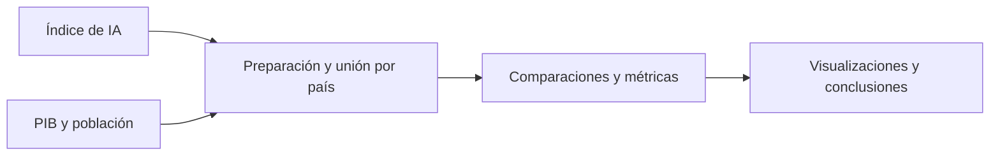

# Ecosistema mundial de IA y posición de España

**Análisis de datos · Visualización · Comparación entre países**

[← Portfolio](../README.md) · [Notebook](code/final_proyect.ipynb) · [Informe](report_proyect.pdf) · [Presentación](Power_Point.odp)

## Qué problema aborda

¿Cómo se sitúa España en el ecosistema mundial de IA y qué diferencias aparecen frente a países de referencia? El trabajo conecta los indicadores del Global AI Index con información de PIB y población para estudiar patrones, brechas y prioridades de inversión.

## Autoría

El informe publicado recoge a **Francisco Gil Valverde y Gastón Fernández Rodríguez**. Se conserva el trabajo completo del equipo; las conclusiones y visualizaciones se presentan como resultados del proyecto compartido.

## Metodología

1. Preparación de indicadores y normalización de identificadores de países.
2. Integración de datos del Banco Mundial sobre PIB y población.
3. Exploración de distribución regional, grupos de renta y pilares del índice.
4. Comparación de España con países de referencia y visualizaciones interactivas en Plotly.

## Qué aporta

El análisis identifica diferencias entre estrategia pública, infraestructura e investigación, y permite explorar dónde se sitúa España respecto a las referencias elegidas. El valor técnico está en preparar fuentes distintas, construir comparaciones interpretables y comunicar resultados visualmente.

Las relaciones observadas son **descriptivas**: una asociación entre indicadores o tipo de régimen político no establece causalidad. Las conclusiones corresponden a la versión del índice y a los datos del experimento, no a una clasificación actualizada en tiempo real.

## Archivos y ejecución

- `code/final_proyect.ipynb`: análisis y gráficos.
- `data/`: índice y ficheros de PIB y población usados.
- `report_proyect.pdf` y `Power_Point.odp`: informe y presentación.

El notebook conserva rutas absolutas de Windows. Para ejecutarlo, instala las dependencias de `requirements.txt` y cambia las tres lecturas de datos para apuntar a `../data/AI_index_db.csv` y a los CSV de PIB y población de `../data/`. Los dos CSV del Banco Mundial se leen con `skiprows=4`. Ejecuta el notebook desde `code/`. [Guía general](../docs/RUNNING.md).

**Stack:** Python, Pandas, NumPy, Plotly y pycountry.
