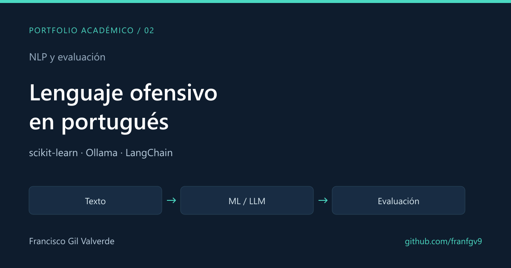

# Detección de lenguaje ofensivo en portugués

**NLP · ML clásico · LLM locales · Evaluación**

[← Portfolio](../README.md) · [ML clásico](code/01_classical_ml_tfidf_glove.ipynb) · [LLM locales](code/02_llm_ollama_langchain.ipynb) · [Informe ML](reports/milestone_2_ML_report.pdf) · [Informe LLM](reports/milestone_3_LLM_report.pdf)

## Qué problema aborda

Clasificación binaria de comentarios de Instagram en portugués brasileño como ofensivos o no ofensivos, utilizando HateBR. El objetivo es comparar representaciones y modelos, y estudiar sus compromisos entre rendimiento, recursos y validez de las respuestas.

## Autoría

Trabajo académico compartido con **Gastón Fernández Rodríguez**, identificado junto a Francisco Gil Valverde en el informe de ML. Los resultados se atribuyen al proyecto del equipo; el material publicado no especifica un reparto individual de tareas.

## Metodología

- **ML clásico:** TF-IDF y GloVe, rasgos lingüísticos, Logistic Regression, SVM y Random Forest; selección y evaluación con particiones diferenciadas.
- **LLM locales:** Llama 3.2 3B y Qwen 2.5 7B-Instruct mediante Ollama y LangChain; zero-shot, few-shot y prompts de razonamiento.
- **Evaluación:** métricas de clasificación, tiempo de inferencia y errores al obtener la etiqueta esperada.

## Resultados y condiciones

| Enfoque | Resultado registrado | Conjunto evaluado |
|---|---|---|
| GloVe + SVM lineal | F1 macro ≈ 0,816 | Test completo de la fase de ML |
| Qwen 2.5 7B-Instruct, few-shot + razonamiento | F1 macro ≈ 0,880 | Subconjunto estratificado de **75 ejemplos** |

Las cifras **no constituyen una comparación directa sobre las mismas observaciones**. El experimento con LLM se redujo por coste computacional. Los rechazos o respuestas no interpretables también afectan a la utilidad del sistema; un F1 aislado no resume todo su comportamiento.

## Qué demuestra

Preparación de texto, comparación de representaciones, selección de modelos y evaluación de LLM con salida estructurada. El análisis de fallos distingue el rendimiento de clasificación de la capacidad de devolver una etiqueta válida.

## Archivos y ejecución

- `code/`: dos notebooks, correspondientes a ML clásico y LLM.
- `data/HateBR.csv`: dataset conservado.
- `reports/`: informes y presentaciones de los hitos publicados.

El notebook de ML usa Google Colab/Drive y requiere el fichero externo `glove_s100.txt`, que no está incluido. Necesita también el modelo de spaCy `pt_core_news_sm` y los recursos de NLTK utilizados en sus celdas.

Para utilizar el CSV local, sustituye la variable `url` por `../data/HateBR.csv`, ejecutando desde `code/`. El notebook de LLM requiere un servicio de Ollama disponible y los modelos indicados en sus celdas. [Dependencias](requirements.txt) · [Guía general](../docs/RUNNING.md).

**Stack:** Python, scikit-learn, spaCy, NLTK, Gensim, Ollama y LangChain.
