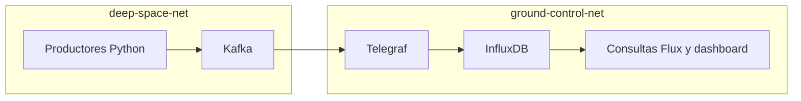

# Telemetría lunar: pipeline de datos en tiempo real

**Streaming · Arquitectura de datos · Docker · Monitorización**

[← Portfolio](../README.md) · [Docker Compose](compose.yaml) · [Informe de decisiones](Architecture_Engineering_Decisions_Report.pdf) · [Dashboard](dashboard/dashboard.json)

## Qué problema aborda

Simular la generación, transmisión y monitorización de telemetría entre un rover y un centro de control. Los productores emulan movilidad, soporte vital y comunicaciones, con ráfagas de datos y señales degradadas.

## Autoría y alcance

Proyecto académico de sistemas e infraestructura, publicado por Francisco Gil Valverde. El informe disponible documenta las decisiones de arquitectura sin un reparto nominal de tareas. Esta presentación describe el sistema del proyecto y evita atribuir componentes concretos en exclusiva.

## Arquitectura



Telegraf se conecta a ambas redes como puente de ingesta. Kafka no expone su puerto al host; los productores se comunican por la red interna. InfluxDB almacena las mediciones y permite consultarlas y visualizarlas.

La separación mediante redes de Docker es **lógica**: Telegraf mantiene una conexión entre ellas. La simulación no constituye un aislamiento físico air gap ni un sistema espacial desplegado.

## Componentes publicados

- `producers/`: simuladores Python, Dockerfile y dependencias.
- `telegraf/telegraf.conf`: consumo de Kafka y escritura en InfluxDB.
- `flux/`: consultas para evaluar umbrales y estados de alerta.
- `dashboard/dashboard.json`: configuración de visualización.
- `compose.yaml`: servicios, redes, volúmenes y healthchecks.

## Ejecución

Desde esta carpeta, con Docker y Docker Compose disponibles:

```powershell
Copy-Item .env.example .env
# Completar los valores de .env antes de arrancar.
docker compose config --quiet
docker compose up --build -d
docker compose ps
```

InfluxDB publica su interfaz en `http://localhost:8086`. Revisa `docker compose logs telegraf-gateway` si no llegan datos. Las consultas de `flux/` y el dashboard se importan/configuran en InfluxDB; no se presentan como aprovisionamiento automático.

Las imágenes del Compose original usan etiquetas `latest`: las versiones y la compatibilidad deben comprobarse al ejecutar. La revisión del portfolio no incluye una ejecución integral del stack. [Guía general](../docs/RUNNING.md).

**Stack:** Python, Kafka, Telegraf, InfluxDB, Flux y Docker Compose.
