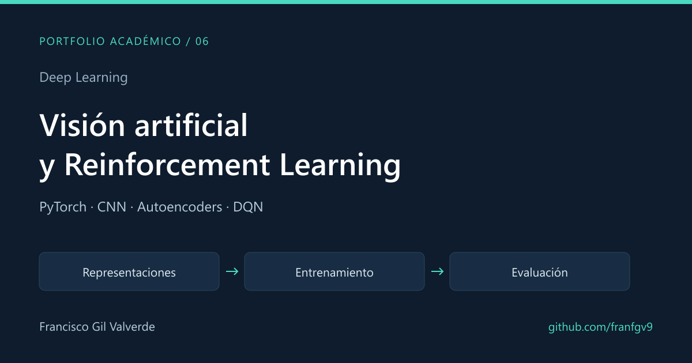

# Deep Learning y Reinforcement Learning

**Visión artificial · Representaciones latentes · Agentes en simulación**

[← Portfolio](../README.md) · [CNN y transfer learning](01-cnn-and-transfer-learning/) · [Autoencoders y YOLO](02-autoencoders-and-yolo/) · [Reinforcement Learning](03-reinforcement-learning/)

Tres trabajos académicos de Applied Deep Learning realizados durante mi estancia en la Universidade de Coimbra, en equipo con **Minnie**. Se publica el trabajo completo y se distingue quién desarrolló cada parte.

## Contribuciones del equipo

| Trabajo | Francisco Gil Valverde | Minnie |
|---|---|---|
| Clasificación de imágenes | CNN sobre CIFAR-10, experimentación con hiperparámetros y data augmentation | Transfer learning y middle fusion sobre STL-10 |
| Representaciones y detección | Implementación y entrenamiento de AE, VAE y DAE; análisis del espacio latente | Dataset, anotación y comparación de detectores YOLO |
| Reinforcement Learning | Agente visual de conducción, discretización de acciones, replay buffer y adaptación del entorno | Agente de navegación de robot con representación vectorial |

La evaluación con un clasificador sobre los encoders forma parte del trabajo compartido, con la contribución de Minnie identificada en su página.

## 1. CNN y transfer learning

Construcción de una CNN con bloques convolucionales, Batch Normalization y Dropout, comparando optimizadores y schedulers. El informe registra **89,35% de accuracy**, **86,18% de mCA** y **86,16% de F1** para la CNN de Fran en CIFAR-10.

La parte de Minnie compara modelos preentrenados y una arquitectura de middle fusion sobre STL-10. Los resultados de ambos bloques corresponden a datasets y configuraciones diferentes.

[Código, resultados y autoría →](01-cnn-and-transfer-learning/)

## 2. Autoencoders y detección de objetos

Comparación de AE, VAE y DAE sobre Kuzushiji-MNIST: reconstrucción, denoising y visualización de representaciones con t-SNE. La segunda parte recoge el trabajo de Minnie con anotación y detectores YOLO.

La clasificación sobre los encoders congelados se presenta como evaluación del trabajo compartido. La tabla del informe registra aproximadamente **89,13% de accuracy para el clasificador sobre el encoder AE**.

[Código, resultados y autoría →](02-autoencoders-and-yolo/)

## 3. Reinforcement Learning

Mi bloque desarrolla un agente de conducción visual en `CarRacingObstacles-v3`, con Double Dueling DQN, 31 acciones discretizadas y almacenamiento del replay buffer en `uint8` para reducir memoria. El informe analiza también el efecto de aleatorizar el entorno sobre la generalización.

El bloque de Minnie compara agentes para navegación de un robot en `IndoorRobot2025-v02`. El vídeo publicado corresponde al fichero `car_model_4.mp4`; no se utiliza como prueba visual del modelo final aleatorizado.

[Código, informe y vídeo →](03-reinforcement-learning/)

## Recursos para volver a ejecutarlo

Los notebooks usan Google Colab, Drive, datasets descargables y checkpoints. Los pesos entrenados y el archivo parcheado del entorno de conducción **no están incluidos** en esta copia. Cada página indica los recursos necesarios; los informes y salidas de los notebooks permiten revisar los experimentos sin reentrenarlos.

**Stack:** PyTorch, Torchvision, NumPy, scikit-learn, Gymnasium, Box2D y Ultralytics en el bloque de detección.
